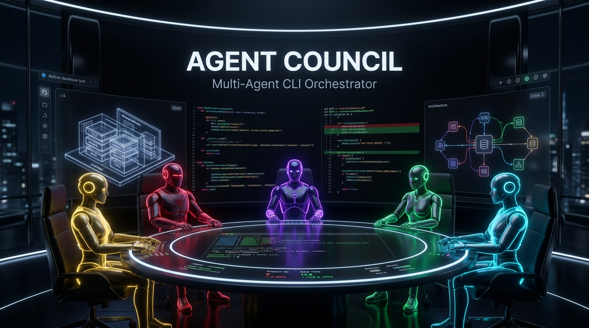
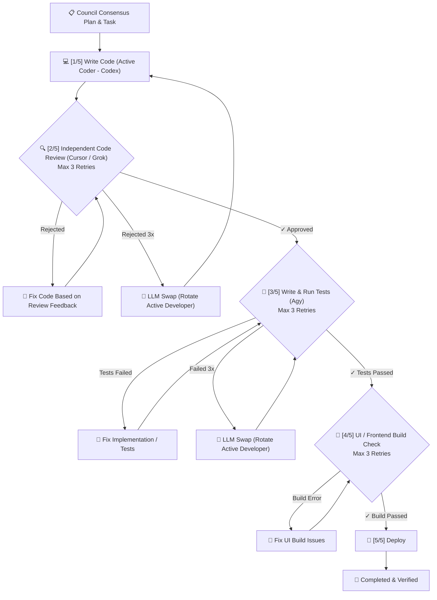

<div align="center">



# 🏛️ AgentCouncil

**Autonomous Multi-Agent CLI Orchestrator for Software Engineering**

[](LICENSE)
[](https://www.python.org/)
[](https://github.com/zekigalip/AgentCouncil/pulls)
[](#-t%C3%BCrk%C3%A7e-dok%C3%BCmantasyon)

*Bring **Claude Code**, **OpenAI Codex**, **Cursor Agent**, **xAI Grok**, and **Google Antigravity (Agy)** into a single terminal council to debate architecture, write code, cross-review `git diff`s, run automated tests, and deploy.*

[🇬🇧 English](#-why-agentcouncil) • [🇹🇷 Türkçe](#-türkçe-dokümantasyon)

</div>

---

## 🌟 Why AgentCouncil?

Instead of relying on a single AI coding assistant—where the same model writes and reviews its own mistakes—**AgentCouncil** orchestrates a specialized 5-agent software engineering team directly inside your terminal:

1. **Multi-Model Deliberation:** Each agent inspects your local repository, builds on the previous agent's findings, and contributes according to its specialized role.
2. **Independent Cross-Model Code Review:** The model that writes the code is **never** the model that reviews the `git diff`.
3. **Automatic LLM Swap on Failure:** If the Coder fails code review or automated tests 3 times in a row, AgentCouncil automatically **swaps the active Coder LLM** to another model in the pool to break out of reasoning loops.
4. **End-to-End Autonomous Execution:** From architectural planning to file edits, unit tests (`pytest`, `npm test`, `cargo test`, `go test`), UI build verification, and deployment.
5. **Bilingual Interface (EN / TR):** Switch seamlessly between English and Turkish anytime by pressing `l` or passing `--en` / `--tr`.

---

## 👥 The Council Roles

| Stage | Default Agent | Provider | Role | Responsibility |
| :---: | :--- | :--- | :--- | :--- |
| **1** | 🟣 **Claude Code** (`claude`) | Anthropic | **Architect & System Analyst** | Inspects the project structure, analyzes requirements, and drafts the technical roadmap. |
| **2** | 🟢 **OpenAI Codex** (`codex`) | OpenAI | **Lead Developer (Coder)** | Evaluates the roadmap, inspects source files, and writes concrete code implementations. |
| **3** | 🔵 **Cursor Agent** (`cursor`) | Cursor | **Senior Code Reviewer** | Reviews proposed changes and `git diff`s for clean code, performance, and refactoring. |
| **4** | 🔴 **xAI Grok** (`grok`) | xAI | **Security & Edge-Case Analyst** | Audits security vulnerabilities, fault tolerance, race conditions, and edge cases. |
| **5** | 🟡 **Google Antigravity** (`agy`) | Google DeepMind | **Principal Engineer & QA Lead** | Synthesizes team consensus, writes/runs test suites, and produces the final action plan. |

*(Also includes extensible metadata support for **Alibaba Qwen**, **Meta AI Muse**, and **Hermes Agent**).*

---

## ⚡ 5-Stage Autonomous Execution Pipeline (`Execute Plan`)

Once the council reaches consensus, selecting **`[1] Execute Plan`** launches the autonomous verification and self-healing loop:



---

## 🚀 Installation & Quick Start

### 1. Clone the Repository

Clone `AgentCouncil` into your workspace/projects folder (by default, it scans its parent directory for projects, or any path set via `AGENT_COUNCIL_SOURCE_DIR`):

```bash
git clone https://github.com/zekigalip/AgentCouncil.git
cd AgentCouncil
pip install -r requirements.txt
```

### 2. Run AgentCouncil

```bash
chmod +x agent-council
./agent-council
```

*(Optional)* Symlink to your `$PATH` to invoke `council` or `agent-council` from anywhere:

```bash
ln -sf "$(pwd)/agent-council" ~/.local/bin/council
ln -sf "$(pwd)/agent-council" ~/.local/bin/agent-council
```

### 3. CLI Flags & Environment Variables

```bash
# Launch in English (default)
council --en

# Launch in Turkish
council --tr

# Point to a custom projects directory
export AGENT_COUNCIL_SOURCE_DIR="$HOME/Projects"
council
```

---
---

<div align="center">

## 🇹🇷 Türkçe Dokümantasyon

**Yazılım Geliştirme İçin Otonom Çoklu-Ajan (Multi-Agent) CLI Orkestratörü**

</div>

Source dizinindeki projeleriniz üzerinde büyük AI kod ajanlarının (**Claude Code**, **OpenAI Codex**, **Cursor Agent**, **xAI Grok**, **Google Antigravity**) birlikte tartışmasını, plan yapmasını ve **bu planı otomatik olarak dosyalara kodlayıp, çapraz code review yapıp, test edip, canlıya dağıtmasını (deploy)** sağlayan terminal orkestrasyon aracı.

### 👥 Aktif Konsey Rolleri

| Ajan | Sağlayıcı | Rol | Durum | İşlev |
| :--- | :--- | :--- | :---: | :--- |
| **Claude Code** (`claude`) | Anthropic | **Mimar & Sistem Analisti** | ✅ Aktif | Projenin mevcut yapısını inceler, mimari durum analizini yapar ve teknik yol haritasını çizer. |
| **OpenAI Codex** (`codex`) | OpenAI | **Geliştirici & Kodlama Uzmanı** | ✅ Aktif | Claude'un mimari planını inceler, projedeki kod dosyalarını okur ve somut fonksiyon/kod çözümlerini yazar. |
| **Cursor Agent** (`cursor`) | Cursor | **Kıdemli Kod İnceleyici & Optimizasyon** | ✅ Aktif | Codex'in kodlarını inceler; kod kalitesi, modern pratikler, performans ve refactoring önerilerini sunar. |
| **xAI Grok** (`grok`) | xAI | **Güvenlik & Uç Durum Analisti** | ✅ Aktif | Güvenlik açıklarını, hata toleransını, ağ/bağlantı kopmalarını ve kritik uç durumları (edge-cases) denetler. |
| **Google Antigravity** (`agy`) | Google DeepMind | **Baş Mühendis, Test & Sentez Lideri** | ✅ Aktif | Ekibin yaklaşımlarını sentezler, test senaryolarını hazırlar, nihai mutabakat raporunu ve eylem planını çıkarır. |

### 🎛️ Rolleri ve Dili Özelleştirme

Proje seçildikten hemen sonra ekranda görev dağılım tablosu listelenir:
* **`[Enter]`**: Varsayılan sıralama ve rollerle devam eder.
* **`[c]`**: Her aşama için istediğiniz ajanı (Claude, Codex, Cursor, Grok, Agy) adım adım atamanızı sağlar.
* **`[l]`**: Arayüz ve ajan prompt dilini anında **İngilizce (`EN`) ↔ Türkçe (`TR`)** arasında değiştirir.

### ⚡ 5 Aşamalı Otonom "Planı Uygula (Execute Plan)" Hattı

1. **💻 Kod Yazımı:** Birinci geliştirici (Codex) planı doğrudan projedeki dosyalara kodlar.
2. **🔍 Bağımsız Code Review (Max 3 Deneme):** Bağımsız inceleyici (Cursor) `git diff`'i inceler. Hata varsa geliştiriciye bildirir. **3 denemede onay çıkmazsa Geliştirici LLM otomatik değiştirilir (LLM Swap)!**
3. **🧪 Test Kodu & Koşumu (Max 3 Deneme):** Test mühendisi (Agy) birim/entegrasyon testlerini yazar ve `pytest`, `npm test`, `cargo test`, `go test` vb. komutlarla koşar. Hatalarda Coder düzeltir; 3 denemede geçmezse LLM swap edilir.
4. **📱 Ekran & UI Build Testi (Max 3 Deneme):** Projede frontend varsa (`npm run build` vb.) UI build testleri koşulur.
5. **🚀 Deploy (Canlı Dağıtım):** Projedeki `./deploy.sh` tetiklenerek değişiklikler canlıya güvenle dağıtılır.

---

## 📄 License

Distributed under the **MIT License**. See [`LICENSE`](LICENSE) for more information.
